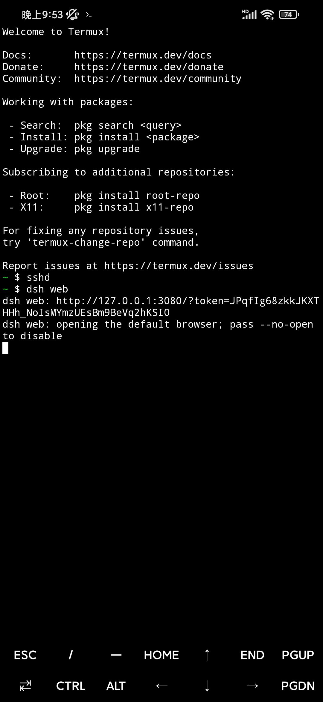
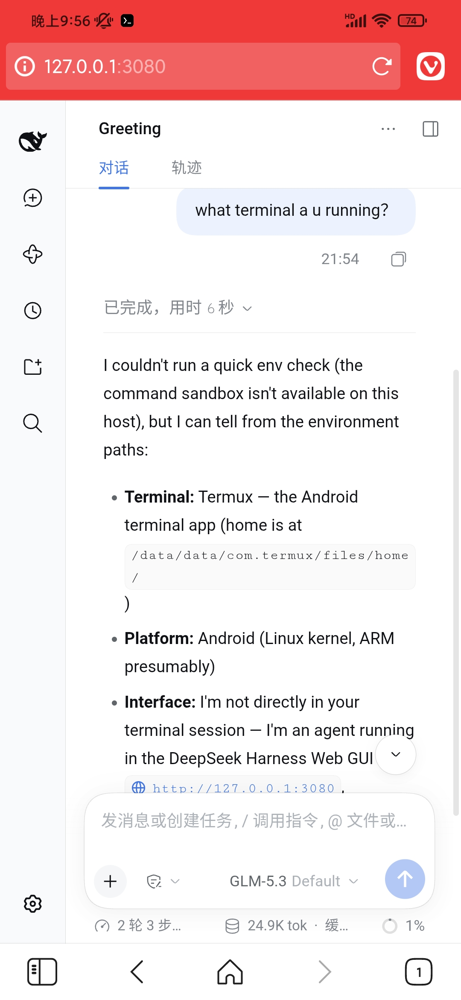

# DeepSeek Harness (Termux)

English | [中文](README.zh.md)

This repository is a fork of [deepseek-ai/deepseek-harness](https://github.com/deepseek-ai/deepseek-harness) that adds native support for Android/Termux.

DeepSeek Harness (`dsh`) is an open-source agent harness developed by [DeepSeek AI](https://deepseek.com), built on an **everything-is-a-plugin** architecture and powered by [Cordis](https://github.com/cordiverse/cordis).

## What changed

Upstream DSH cannot be installed or run on Termux (Android arm64, bionic libc). These changes make it work without root or post-install patches:

- **koffi ^3.3.2** compiles on bionic and ships android-arm64 prebuilts, so installs never compile it.
- **`node-addon-require-builtin` fallback**: when the addon is unusable, DSH requires Node internals directly under `--expose-internals`; the CLI relaunches itself once with that flag.
- **flock via koffi**: where no prebuilt system addon exists, the session lock calls bionic's `flock(2)` through koffi.
- **link → rename**: when SELinux denies hard links, session logs publish by `rename(2)` instead of `link(2)`, so no Magisk policy module is needed.

## Deploy

Build a self-contained deployment set on a computer, then install it on the phone with plain `npm install`.

### On the computer

Requires Node and pnpm. From the repository root:

```sh
pnpm install
pnpm run build:official
pnpm run release:pack --family dsh --out dist/dsh --concurrency 8
pnpm run release:pack --family vendor --out dist/vendor --concurrency 8
pnpm --dir native/system/packages/entry pack --pack-destination ../../../../dist/native
pnpm exec tsx scripts/release/pack-offline-deploy.ts dist/offline-deploy dist/dsh dist/vendor dist/native
tar -czf dist/offline-deploy.tar.gz -C dist offline-deploy
```

`pack-offline-deploy.ts` computes the runtime dependency closure of `@deepseek-ai/dsh` and writes a `package.json` whose entries point at the copied tarballs through `file:` paths, so the phone resolves every workspace package locally. Then copy `dist/offline-deploy.tar.gz` to the phone (Termux runs `sshd` on port 8022):

```sh
scp -P 8022 dist/offline-deploy.tar.gz <user>@<phone-ip>:~/
```

### On the phone

Requires Termux and Node.js 24 or later (`pkg install nodejs`). Unpack and install:

```sh
mkdir offline-deploy
tar -xzf offline-deploy.tar.gz --strip-components=1 -C offline-deploy
cd offline-deploy
sh install.sh
```

npm blocks install scripts until they are approved. Approve the packages the first time and reinstall; otherwise `koffi` and `node-pty` stay unbuilded and `dsh web` fails:

```sh
npm install-scripts approve koffi node-pty protobufjs @deepseek-ai/dsh-subprocess-local
rm -rf node_modules package-lock.json
sh install.sh
```

## Run

```sh
./node_modules/.bin/dsh web
```

The command prints a tokenized URL for the Web UI at `http://127.0.0.1:3080`. The first launch restarts itself once to add `--expose-internals`; that is expected.

To make `dsh` a global command, symlink it:

```sh
ln -s ~/offline-deploy/node_modules/.bin/dsh $PREFIX/bin/dsh
dsh web
```
<table>
  <tr>
    <td></td>
    <td></td>
  </tr>
</table>

## License

[MIT](LICENSE)

Third-party dependencies and their licenses are disclosed in [THIRD_PARTY_NOTICES.md](THIRD_PARTY_NOTICES.md).
