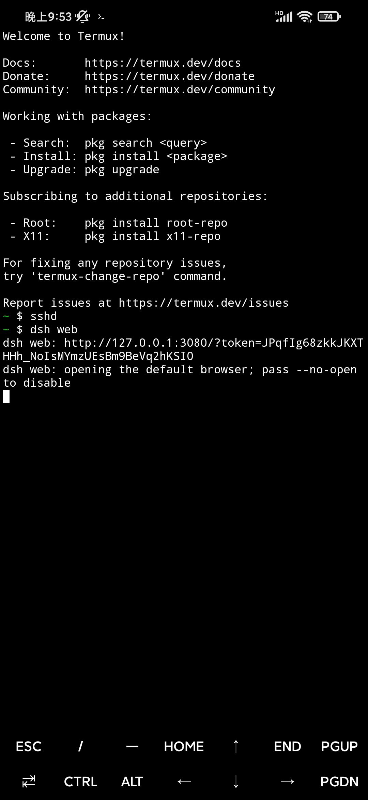
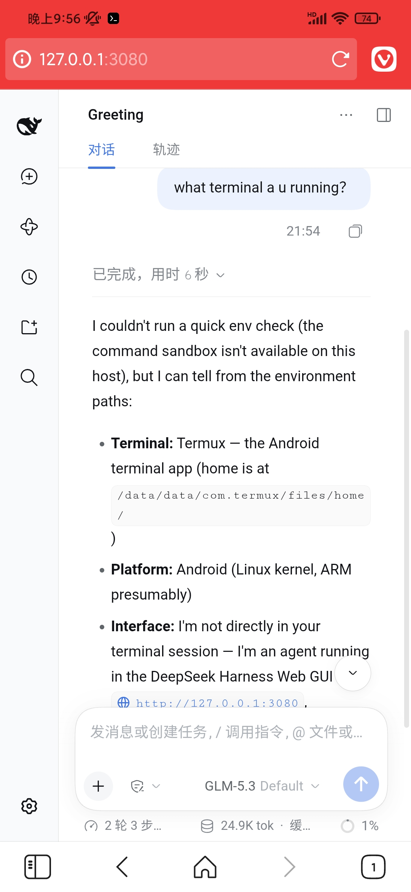

# DeepSeek Harness (Termux)

[English](README.md) | 中文

本仓库 fork 自 [deepseek-ai/deepseek-harness](https://github.com/deepseek-ai/deepseek-harness)，为 Android/Termux 添加原生支持。

DeepSeek Harness（`dsh`）是由 [DeepSeek AI](https://deepseek.com) 开发的开源 agent harness（智能体框架），构建于**一切皆插件**的架构之上，由 [Cordis](https://github.com/cordiverse/cordis) 驱动。


## 主要改动

DSH原版无法在Termux（Android arm64，bionic libc）安装或运行。本次修改后使其无需root、无需补丁即可工作：

- **koffi ^3.3.2** 可在 bionic 上编译，并提供 android-arm64 预编译包，安装时无需编译。
- **`node-addon-require-builtin` 回退**：该 addon 不可用时，DSH 在 `--expose-internals` 下直接 require Node 内部模块；CLI 会自动带该参数重拉一次。
- **经 koffi 调用 flock**：没有预编译系统 addon 时，会话锁通过 koffi 调用 bionic 的 `flock(2)`。
- **link → rename**：SELinux 拒绝硬链接时，会话日志改用 `rename(2)` 发布，不再需要 Magisk 策略模块。


## 部署

需在电脑上生成自包含的部署集，再在手机上用普通 `npm install` 安装。

### 电脑端

需要 Node 和 pnpm。在仓库根目录执行：

```sh
pnpm install
pnpm run build:official
pnpm run release:pack --family dsh --out dist/dsh --concurrency 8
pnpm run release:pack --family vendor --out dist/vendor --concurrency 8
pnpm --dir native/system/packages/entry pack --pack-destination ../../../../dist/native
pnpm exec tsx scripts/release/pack-offline-deploy.ts dist/offline-deploy dist/dsh dist/vendor dist/native
tar -czf dist/offline-deploy.tar.gz -C dist offline-deploy
```

`pack-offline-deploy.ts` 计算 `@deepseek-ai/dsh` 的运行时依赖闭包，生成 `package.json`，其中每条依赖通过 `file:` 路径指向已拷贝的 tarball，手机端因此能完全在本地解析每个 workspace 包。然后将 `dist/offline-deploy.tar.gz` 传到手机（Termux 的 `sshd` 监听 8022 端口）：

```sh
scp -P 8022 dist/offline-deploy.tar.gz <user>@<phone-ip>:~/
```

### 手机端

需要 Termux 和 Node.js 24 或更高版本（`pkg install nodejs`）。解压并安装：

```sh
mkdir offline-deploy
tar -xzf offline-deploy.tar.gz --strip-components=1 -C offline-deploy
cd offline-deploy
sh install.sh
```

npm 在安装脚本获批前会拦截它们。首次需放行以下包并重装，否则 `koffi` 和 `node-pty` 不会被构建，`dsh web` 将失败：

```sh
npm install-scripts approve koffi node-pty protobufjs @deepseek-ai/dsh-subprocess-local
rm -rf node_modules package-lock.json
sh install.sh
```

<a id="run"></a>

## 运行

```sh
./node_modules/.bin/dsh web
```

该命令打印 Web UI 的带 token URL，地址为 `http://127.0.0.1:3080`。首次启动会自动重启一次以添加 `--expose-internals`，属正常现象。

也可通过建立软链接方式，将 `dsh` 设为全局命令：

```sh
ln -s ~/offline-deploy/node_modules/.bin/dsh $PREFIX/bin/dsh
dsh web
```
<table>
  <tr>
    <td></td>
    <td></td>
  </tr>
</table>

## 许可证

[MIT](LICENSE)

第三方依赖及其许可证见 [THIRD_PARTY_NOTICES.md](THIRD_PARTY_NOTICES.md)。
